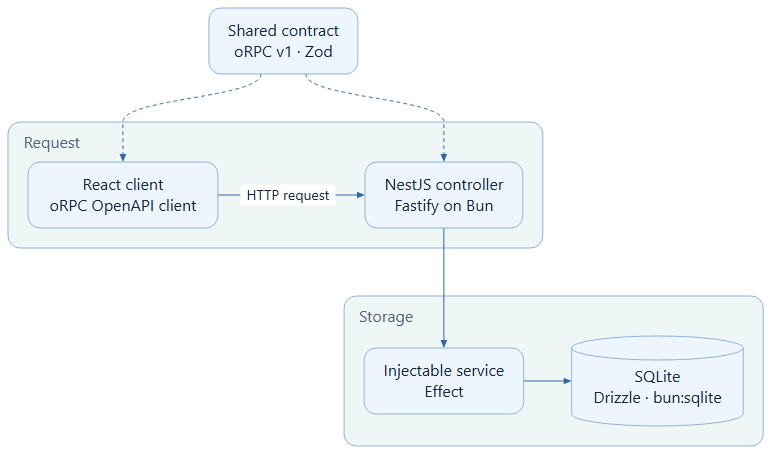

# Lightweight web app starter

A copyable Bun workspace with a React 19 client and a NestJS/Fastify API on Bun. The Notes example is intentionally disposable.

## Stack

- **Client:** React 19, Vite+, TanStack Router and Query.
- **API:** NestJS controllers, modules, and services using Fastify on Bun.
- **Shared types:** an oRPC v1 contract in `shared/notes.contract.ts`. Zod validates request bodies; the controller and browser client use the same route and response types.
- **Data:** Effect handles storage errors; Drizzle accesses SQLite through `bun:sqlite`.



## Prerequisites

- Bun 1.4.4 (`bun --version`)
- Node.js 22.18 or newer (required by the Vite+ CLI)

## Install

```bash
bun install
```

## Develop

```bash
bun run dev
```

- Client: <http://localhost:5173>
- API: <http://localhost:3000>
- Vite proxies `/api` to the Bun server.

`bun run dev` starts both processes with `bun run --parallel`, so no second terminal or extra tooling is needed. The two-terminal path still works if you prefer it: `bun run dev:server` in one terminal and `bun run dev:client` in another.

## Build and static checks

```bash
bun run check
```

`bun run check` runs two steps:

1. `bun run routes` — `tsr generate` regenerates `client/src/routeTree.gen.ts` (ignored by git) without a full build, so a fresh clone type checks immediately.
2. `vp check` — Vite+ formatting (Oxfmt), linting (Oxlint), and full TypeScript checks (type-aware Oxlint with `typescript-go`/tsgolint) across both `client/` and `server/`. Run it from the repository root so the root `vite.config.ts` applies.

`bun run typecheck` is the same type check without formatting or linting (`bun run routes && vp check --no-fmt --no-lint`).

`bun run verify` is the full gate: `check` + `test` + `build`.

## Vite+ tooling

This baseline uses the project-local Vite+ CLI (`vite-plus@1.4.0`); no global install is needed.

| Tool                       | Status                | Notes                                                                                                             |
| -------------------------- | --------------------- | ----------------------------------------------------------------------------------------------------------------- |
| `vp dev`                   | Active                | Client dev server (`bun run dev:client`) with the React Compiler, router plugin, and `/api` proxy.                |
| `vp build`                 | Active                | Client production build (`bun run build`).                                                                        |
| `vp check`                 | Active                | Formatting, linting, and full type checks for `client/` and `server/`; the normal static check (`bun run check`). |
| `vp fmt`, `vp lint`        | Active via `vp check` | Root config lives in `vite.config.ts`; generated and vendored paths are ignored.                                  |
| `vp test` / Vitest         | Not used              | The only tests are server integration tests; see below.                                                           |
| `vp run`                   | Not used              | Root scripts already delegate through Bun workspace filters; Vite Task would duplicate that plumbing.             |
| `vp create` / `vp migrate` | Not used              | The project is hand-authored; generators and codemods are out of scope.                                           |
| `vp pack` / tsdown         | Not applicable        | No library package is published from this app.                                                                    |

Server tests use `bun:test` on purpose: they exercise the NestJS/Fastify app against an in-memory `bun:sqlite` database through the checked-in Drizzle migration. `bun run test` delegates to `bun test` in `server/`.

## API contract

`shared/notes.contract.ts` defines the routes, request validation, and response types for `GET /api/notes` and `POST /api/notes`. `server/src/notes/notes.controller.ts` implements them with the Nest controller decorator `@Implement` and calls the injectable `NotesService`. `client/src/api.ts` uses a contract-driven oRPC OpenAPI client. No generated API client is needed.

`@client/...` resolves to `client/src/`, `@server/...` to `server/src/`, and `@shared/...` to `shared/`. The client imports the shared contract, not the server application.

## Environment

The server validates its environment at boot in `server/src/env.ts` and fails fast on invalid values:

| Variable        | Default              | Notes                                    |
| --------------- | -------------------- | ---------------------------------------- |
| `PORT`          | `3000`               | Integer, 1-65535                         |
| `DATABASE_PATH` | `server/data/app.db` | Absolute, or relative to the process cwd |
| `NODE_ENV`      | `development`        | `development`, `test`, or `production`   |

## Database

- Default path: `server/data/app.db` (ignored by git)
- Override: set `DATABASE_PATH` to an absolute path or a path relative to the process cwd
- WAL is enabled for file databases
- Startup applies pending migrations automatically

Generate a migration after changing `server/src/notes/schema.ts`:

```bash
bun run db:generate
```

Apply migrations explicitly:

```bash
bun run db:migrate
```

Expected output: `Migrated <repo>/server/data/app.db`. The database file and its `-wal`/`-shm` companions are ignored by git. The generated `server/drizzle/` directory is checked in. `server/data/` and `*.db*` files are not.

## Production

```bash
bun run build
bun run start
```

- The Bun process serves `/api/*` and `client/dist`.
- `GET /api/*` misses return JSON 404s and never fall through to `index.html`.
- Other GET paths fall back to `index.html` for client-side routing.
- Responses are gzip-compressed when the client sends `Accept-Encoding` (HTML, JS, and JSON above the middleware's size threshold).
- `/assets/*` is served with `Cache-Control: public, max-age=31536000, immutable`; `index.html` (including the SPA fallback) is `no-cache`, so deploys are picked up immediately.
- Default port: 3000. Override with `PORT`.
- Default database: `server/data/app.db`. Override with `DATABASE_PATH`.

## Removing or renaming the Notes example

Delete or replace these files together:

- `client/src/routes/index.tsx` — the page
- `client/src/api.ts` — the typed client and Notes helpers
- `shared/notes.contract.ts` — the shared contract
- `server/src/notes/notes.controller.ts`
- `server/src/notes/notes.module.ts`
- `server/src/notes/notes.service.ts`
- `server/src/notes/schema.ts`
- `server/drizzle/` — the Notes migration history
- `server/test/notes.test.ts`

Then:

- Remove `NotesModule` from the imports in `server/src/app.ts`.
- Replace the `db` provider in the app factory when you introduce a new schema.
- Remove `server/data/` for a clean database.
- Keep the root workspace, `client/vite.config.ts`, `server/src/db.ts`, and the static-hosting code.

To rename rather than remove, replace `Notes`, `notes`, and `/api/notes` consistently across those files, then regenerate migrations only if the table name changes.

## Layout

- `client/` — React 19, Vite+, TanStack Router and Query, oRPC OpenAPI client
- `server/` — NestJS/Fastify on Bun, oRPC v1, Effect, Zod, Drizzle, SQLite
- `shared/` — the oRPC v1 API contract used by client and server
- `server/data/` — persistent SQLite files (ignored)

The diagram source is [`architecture.mmd`](architecture.mmd); the README uses [`architecture.png`](architecture.png).

## Verification

From a fresh clone:

```bash
bun install --frozen-lockfile
bun run verify
```

Expected: `bun run check` (format, lint, typecheck) and `bun run build` exit 0; the Notes integration tests report `8 pass`, `0 fail`.

Production check:

```bash
bun run build
bun run start
```

Then confirm:

```powershell
curl.exe -s -o NUL -w "%{http_code}`n" http://localhost:3000/
curl.exe -s -o NUL -w "%{http_code}`n" http://localhost:3000/some/deep/link
curl.exe -s -i http://localhost:3000/api
curl.exe -s -i http://localhost:3000/api/unknown
```

Expected: `200`, `200`, and JSON `404` responses for both `/api` and `/api/unknown`.

Manual browser check (when a browser is available): open <http://localhost:5173>, add a note, refresh, and confirm the note remains. The API process must be running on port 3000.

## Copying this baseline

To start a new project:

1. Copy the repository without `node_modules/`, `client/dist/`, `client/src/routeTree.gen.ts`, and `server/data/`.
2. Run `bun install`.
3. Rename the root package and the `client`/`server` package names if desired.
4. Replace the Notes example using the removal list above.
5. Keep `server/src/db.ts`, the static-hosting block in `server/src/app.ts`, and `client/vite.config.ts`.
6. Run `bun run check` and `bun run test` after the replacement.

Never commit `server/data/`, `client/dist/`, or the generated route tree.
